<p align="center">
  <a href="#projects">
    
  </a>
</p>

<p align="center">
  <a href="https://morabaraba.dev"><b>play morabaraba</b></a> ·
  <a href="mailto:motaungjosh1024@gmail.com">email</a> ·
  <a href="https://www.linkedin.com/in/joshua-motaung-348668278/">linkedin</a> ·
  <a href="#projects">projects</a>
</p>

```text
$ cat profile.txt
name      Joshua Motaung
role      Software engineer · CS + ML/AI · United States
shipped   Morabaraba: 7,600+ players, 255k+ matches, designed and run end to end
shipped   Flow: AI agents that apply to jobs, live on the web and the App Store
owns      product, game engine, backend, infrastructure, data
approach  ship it, measure it, keep what works
```

## Real products, real users

**Morabaraba** · [morabaraba.dev](https://morabaraba.dev)<br>
The Southern African strategy game, built solo and live online. Play the computer, a friend, or real people, with leaderboards and tournaments.

**Flow by Autonlabs** · [flow.autonlabs.co](https://flow.autonlabs.co) · [App Store](https://apps.apple.com/app/flow-io/id6787564220)<br>
An AI job-hunting service. Its agents find jobs that fit you and apply to them for you, through companies' own hiring systems.

## Morabaraba in numbers

Launched August 2026. Figures as of November 2026.

| | |
| ---: | :--- |
| **7,600+** | player accounts |
| **255,000+** | matches played |
| **146,000+** | online games between real people |
| **6.6 million** | moves played online |
| **9,000+ hours** | of online play |
| **3,249** | online matches on the busiest day |
| **48** | tournaments run |

## Projects

### Morabaraba

**[morabaraba.dev](https://morabaraba.dev)** · source private

A full digital version of Morabaraba, the traditional Southern African board game, played against the computer, a friend on the same phone, or real people online.

- **Computer opponent** that searches ahead in a Web Worker and keeps thinking on the player's time. It also learns openings from real games, and I tune it with self-play and A/B tests.
- **Live online play** with matchmaking, a move clock, and results that both players' devices must agree on before they count.
- **Accounts, leaderboards, friends and tournaments**, with no sign-up wall: a name and a PIN.
- **Installable web app** that works on phones as a home-screen app.

Stack: `TypeScript` `React` `Vite` `Supabase` `PostgreSQL` `Vercel` `Python`

---

### Versiontrail

[github.com/Motaung1024/versiontrail](https://github.com/Motaung1024/versiontrail)

Like GitHub, but for the process of building, not just the result. Versiontrail records the prompts, AI responses, file changes, checkpoints, tests and decisions of AI-assisted coding in one timeline, so the work can be inspected and restored afterwards.

Stack: `TypeScript` `Fastify` `Prisma` `PostgreSQL`

---

### CrossBuy

[github.com/Motaung1024/crossbuy](https://github.com/Motaung1024/crossbuy)

A parcel-forwarding platform that helps customers in Lesotho buy from South African retailers at a clear final price, with exchange rates, customs duty, VAT and delivery worked out up front.

Stack: `Python` `FastAPI` `PostgreSQL` `Docker`

## Stack

**Languages**

<a href="#stack"></a>

**Frameworks**

<a href="#stack"></a>

**Data and infrastructure**

<a href="#stack"></a>

**Tools**

<a href="#stack"></a>

Also: Render, SQL, LLM agents, browser automation and self-play training.

## How I work

```text
Evidence over opinion   I test changes and keep only what measurably works.
Ship carefully          Real people use what I build, so I check before I release.
Respect users           Collect only what is needed, and keep it anonymous where possible.
```

## Contact

Happy to talk about games, AI agents, real-time systems, or a project idea.

- Email: [motaungjosh1024@gmail.com](mailto:motaungjosh1024@gmail.com)
- LinkedIn: [linkedin.com/in/joshua-motaung-348668278](https://www.linkedin.com/in/joshua-motaung-348668278/)
